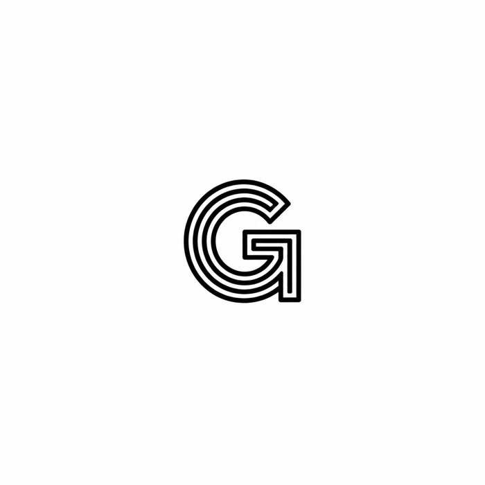

<p align="center">
  
</p>

<h1 align="center">GastroTech</h1>

<p align="center">
  Sistema completo de pedidos para lanchonete: do totem de autoatendimento à cozinha e ao caixa.
</p>

<p align="center">
  
  
  
  
  
</p>

## Funcionalidades

| Módulo | O que faz |
|---|---|
| 🛒 **Totem** | O cliente monta o pedido sozinho, com carrinho em JavaScript |
| 👩‍🍳 **Cozinha** | Fila de pedidos para a equipe preparar |
| 🔐 **Painel administrativo** | Acesso com login; cadastro de produtos, categorias e usuários |
| 🖼️ **Personalização** | Troca de logo, nome da loja e imagens dos produtos pelo painel |
| 💰 **Financeiro** | Controle de vendas e movimentos de caixa |

## Acesso de demonstração

```text
Usuário: admin
Senha: 123
```

## Como abrir

1. Ligue o MySQL no XAMPP.
2. Importe o arquivo `database/database.sql` no phpMyAdmin.
3. Abra a pasta do projeto no VS Code.
4. Rode o servidor PHP:

```text
C:\xampp\php\php.exe -S 127.0.0.1:5520 -t .
```

5. Acesse no navegador:

```text
http://127.0.0.1:5520/src/pages/totem.php
```

Para abrir o painel:

```text
http://127.0.0.1:5520/src/pages/login.php
```

## Pastas principais

- `app`: conexão, login, funções e arquivos que falam com o banco.
- `database`: arquivo SQL para importar no MySQL.
- `src/pages`: telas do sistema.
- `src/styles`: CSS das telas.
- `src/assets/brand`: logo da loja.
- `src/assets/images/menu`: imagens dos produtos.
- `legacy`: versão antiga guardada como backup.

## Telas

- `totem.php`: tela usada pelo cliente.
- `login.php`: entrada do painel.
- `dashboard.php`: resumo geral.
- `produtos.php`: cadastro e edição dos produtos.
- `categorias.php`: cadastro das categorias.
- `cozinha.php`: fila de pedidos.
- `financeiro.php`: caixa e vendas.
- `administradores.php`: usuários do painel.
- `configuracoes.php`: logo, nome da loja e tempo médio.

## Banco de dados

O arquivo `database/database.sql` cria as tabelas usadas no projeto:

- administradores;
- configurações do sistema;
- categorias;
- produtos;
- pedidos;
- itens do pedido;
- caixa;
- movimentos do caixa.

## Imagens

As imagens dos produtos ficam em:

```text
src/assets/images/menu
```

Pelo painel, abra **Produtos**, edite um item e envie uma imagem nova. O caminho fica salvo no banco.

A logo fica em:

```text
src/assets/brand
```

Ela pode ser trocada em **Configurações**.

## Observações

- O painel administrativo exige login.
- O totem fica aberto para uso do cliente.
- O carrinho do totem usa JavaScript dentro do próprio `totem.php`.
- Os cadastros e pedidos ficam salvos no MySQL.
- A pasta `app/sessoes` não vai para o Git, porque guarda sessões temporárias do login.

## Documentação

Também deixei um guia mais simples em:

```text
GUIA_DO_CODIGO.md
```

E a documentação técnica em:

```text
docs/documentacao_tecnica_gastrotech.md
```
